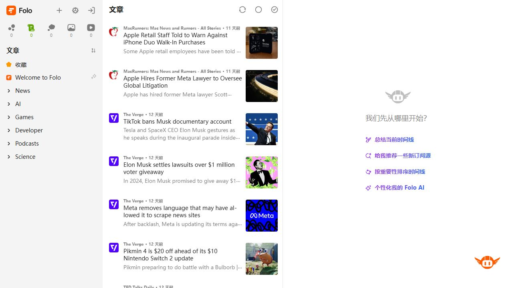
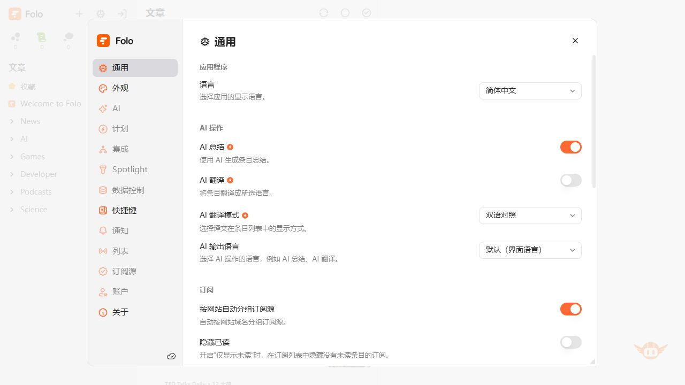

# 01 · Folo 参考研究

> 参考资料库，不是需要逐项迁移的功能清单。采用与否以 [00 · 专业软件的完成度](./00-product-quality-bar.md) 和当前页面任务判断。

## 1. 研究范围与可信度

日期：2026-10-29。查阅 [Folo 仓库](https://github.com/RSSNext/Folo) 与 [公开 Web 应用](https://app.folo.is/)。
源码固定在 [68edee9](https://github.com/RSSNext/Folo/tree/68edee907003a90877f2ffa6bd9ed9bedababfd4)，在线部署未公开对应提交，**两者不假定完全一致**。

证据分三类：

| 标记 | 含义 | 可以支持的结论 |
| --- | --- | --- |
| V | 本轮匿名演示页实际观察、截图已检查 | 当时可见的布局、菜单、设置分组与列表到详情的变化 |
| C | 固定提交下源码已核对 | 条件触发、延迟、焦点处理、按需计算等实现机制 |
| S | 针对 Synra 的设计建议 | 从参考中抽象出的方案；不代表 Folo 或 Synra 现有行为 |

没有登录、修改 Folo 偏好或执行内容管理操作；没有测试其原生客户端和移动客户端。
不能从这些截图推断 Folo 全面通过无障碍测试，或者所有列表模式都显示同一种 hover 工具栏。

## 2. 实际观察的四步

### V1 · 默认列表：稳定导航与短摘要

左侧处理来源与分类，中部以标题为主、来源和时间为辅，右侧承担当前上下文。
同一条记录没有同时展开所有属性与操作；标题、摘要、元数据之间有明显层次。

**Synra 对应**：设备/插件采用可连续扫描的列表，正常记录只给足够辨认的信息；描述、标识、权限不全部展开。
右侧默认 AI 引导不适合宿主，不能因此在 Synra 新增助手或推荐业务功能。

### V2 · 设置：分组导航与对齐的控制项

设置使用左侧分类，当前分类在独立内容区滚动；标签与控件对齐，说明退居第二行。
访问期间曾出现登录提示，关闭后才保存这张无遮挡截图。只观察可读界面，没有确认保存行为。

**Synra 对应**：保留设置路由，增加页内分类和稳定控件行；不必照搬可拖拽、可缩放的设置弹窗。
Folo 分类数量来自其业务规模，Synra 不需要同样多的分类。

### V3 · 选中对象：详情改变，列表上下文保留

点击条目后，原列表仍可见，选中项具有稳定高亮，右侧显示内容和当前对象的工具栏。
界面没有把每条列表都扩展成详情，用户能够连续切换对象。

**Synra 对应**：插件详情容纳权限/更新/审计；宽屏可并排，较窄窗口改为 Drawer 或单页。
不应在 1024px 窗口强塞导航、列表、详情三个固定宽度面板。

### V4 · 更多菜单：高频入口与次要动作分开

对象工具栏保持短小，其余动作以具名菜单展示。截图显示了工具栏与菜单的关系，不代表已实际执行其中动作。

**Synra 对应**：检查更新、同步、审计、移除进入明确的菜单/详情；“打开插件”作为高频入口保留。
右键可以是加速入口，但不能是唯一入口。

## 3. 源码核对与迁移判定

下面每行都给出固定版本来源。**C 项不声称在本轮在线界面逐一触发过**。

| # | Folo 机制与证据 | 为什么有用 | Synra 采用方式 |
| --- | --- | --- | --- |
| C1 | 条目条件显示 `ActionBar`，同时要求 `showAction && isWide`；[EntryItemWrapper](https://github.com/RSSNext/Folo/blob/68edee907003a90877f2ffa6bd9ed9bedababfd4/apps/desktop/layer/renderer/src/modules/entry-column/layouts/EntryItemWrapper.tsx#L185-L217) | 操作出现在需要的对象附近 | S：行尾预留操作区，hover/focus 时显示次要快捷操作；不照搬其全部触发条件 |
| C2 | 工具栏拦截点击冒泡；更多按钮有可访问名称；[ActionBar](https://github.com/RSSNext/Folo/blob/68edee907003a90877f2ffa6bd9ed9bedababfd4/apps/desktop/layer/renderer/src/modules/entry-column/layouts/EntryItemWrapper.tsx#L222-L272) | 点击动作不会同时打开条目 | S：行内开关、更多、打开与行选中严格分离，避免重复调用 |
| C3 | `useHoverPopover` 区分 hover/press，默认打开 100ms、关闭 300ms；[hook](https://github.com/RSSNext/Folo/blob/68edee907003a90877f2ffa6bd9ed9bedababfd4/apps/desktop/layer/renderer/src/hooks/common/useHoverPopover.ts#L8-L48) | 预览与主动操作不是同一种状态 | S：只读预览不夺焦点；点击后进入稳定交互状态，移开鼠标不自动关闭 |
| C4 | 忽略 touch pointer；键盘打开处理作用域、Escape 与焦点归还；[hook 后半](https://github.com/RSSNext/Folo/blob/68edee907003a90877f2ffa6bd9ed9bedababfd4/apps/desktop/layer/renderer/src/hooks/common/useHoverPopover.ts#L51-L106) | hover 不成为触摸/键盘障碍 | S：信息弹层具备点击替代；输入框与弹层打开时暂停全局单键快捷键 |
| C5 | Feed 预览使用 300ms 打开、100ms 关闭，并从已有 store 读信息；[FeedPreviewCard](https://github.com/RSSNext/Folo/blob/68edee907003a90877f2ffa6bd9ed9bedababfd4/apps/desktop/layer/renderer/src/components/ui/hover-preview/FeedPreviewCard.tsx#L19-L66) | 快速扫过时不弹出一堆信息 | S：设备/插件预览只读现有快照；不在每次 hover 重新发 IPC 或网络请求 |
| C6 | 订阅栏宽度有上下限，拖拽结束保存，支持恢复默认；[SubscriptionColumn](https://github.com/RSSNext/Folo/blob/68edee907003a90877f2ffa6bd9ed9bedababfd4/apps/desktop/layer/renderer/src/modules/app-layout/subscription-column/SubscriptionColumn.tsx#L96-L113) | 用户可以调节工作区 | S：先做可用的响应式；可调宽后置，不能成为首批额外依赖 |
| C7 | 移动端禁用分隔拖拽，详情显示由当前选择决定；[TimelineLayout](https://github.com/RSSNext/Folo/blob/68edee907003a90877f2ffa6bd9ed9bedababfd4/apps/desktop/layer/renderer/src/modules/app-layout/ai-enhanced-timeline/AIEnhancedTimelineLayout.tsx#L45-L92) | 同一任务适配不同空间 | S：宽屏并排、窄屏单对象，不把桌面 hover 工具条机械缩小 |
| C8 | 设置布局使用分类导航，最小宽度随视口限制；[SettingModalLayout](https://github.com/RSSNext/Folo/blob/68edee907003a90877f2ffa6bd9ed9bedababfd4/apps/desktop/layer/renderer/src/modules/settings/modal/layout.tsx#L59-L145) | 管理规模增长时不会只剩长表单 | S：分类设置，内容有限宽；不引入自由拖动弹窗 |
| C9 | Cmd-K 在打开后建立本地搜索实例，结果逐页渲染，并处理输入法组合态；[cmdk](https://github.com/RSSNext/Folo/blob/68edee907003a90877f2ffa6bd9ed9bedababfd4/apps/desktop/layer/renderer/src/modules/panel/cmdk.tsx#L33-L120) | 快捷入口也控制初始化与渲染成本 | S：后置全局查找，先做管理入口与已有对象，不增加插件业务命令注册 API |
| C10 | 命令有集中抽象；[Command README](https://github.com/RSSNext/Folo/blob/68edee907003a90877f2ffa6bd9ed9bedababfd4/apps/desktop/layer/renderer/src/modules/command/README.md) | 按钮、菜单与快捷键不容易走向不同语义 | S：共享轻量动作定义与 enabled/busy 规则，避免复制业务逻辑或照搬命令框架 |
| C11 | 设置支持定位到某一节并高亮；[section.tsx](https://github.com/RSSNext/Folo/blob/68edee907003a90877f2ffa6bd9ed9bedababfd4/apps/desktop/layer/renderer/src/modules/settings/section.tsx#L13-L71) | 通知跳转后用户能找到目标 | S：注册表错误直达“插件与来源”；高亮用已有动效 token，并尊重 reduced motion |
| C12 | 图片/媒体的辅助层在 hover 出现，移动端有常显分支；[list-item-template](https://github.com/RSSNext/Folo/blob/68edee907003a90877f2ffa6bd9ed9bedababfd4/apps/desktop/layer/renderer/src/modules/entry-column/templates/list-item-template.tsx#L345-L382) | 相同功能可采用不同可见性 | S：触摸端常显“更多”，不要求先触碰一次才能看见第二次要点的按钮 |

Folo 的两个延迟配置服务于不同组件，**没有一套全软件统一的 300ms 数字**；Synra 的建议值见 [04](./04-interaction-patterns.md)，应集中定义并实测。

## 4. 明确不迁移的设计

| 做法 | 不迁移的理由 |
| --- | --- |
| hover 自动标为已读 | [源码确有可选行为](https://github.com/RSSNext/Folo/blob/68edee907003a90877f2ffa6bd9ed9bedababfd4/apps/desktop/layer/renderer/src/modules/entry-column/layouts/EntryItemWrapper.tsx#L60-L92)，但 Synra 的 hover 只能预览，不能授权、启动、取消或修改配置 |
| 三栏常驻与默认 AI 面板 | 信息规模和业务目的不同；Synra 只有需要详情时才增加一个区域 |
| 鼠标移到边缘自动展开导航 | 容易误触，且 Synra 只有四个导航入口，保持稳定更重要 |
| 内容卡片、媒体播放控制、订阅树 | 不属于通用宿主；不能借“参考功能”把业务塞回首页 |
| 自定义工具栏、拖拽设置窗口、完整命令框架 | 首批成本高于收益；先把固定层级做好，再根据使用需求增加 |
| Folo 配色、图标、字体、React 组件源码 | 本轮参考交互，不移植代码和素材，沿用 Synra 自有主题及组件体系 |

## 5. 外部规范补充

采用 hover 信息时，遵循 [WCAG 1.4.13 解释](https://www.w3.org/WAI/WCAG22/Understanding/content-on-hover-or-focus.html)：可关闭、指针可进入、保持足够阅读时间。
[WAI Tooltip Pattern](https://www.w3.org/WAI/ARIA/apg/patterns/tooltip/) 区分只读提示与包含可聚焦控件的弹层；按钮不应塞进 Tooltip。
APG 的该页面仍标为工作草案，因此这里把它作为实现指引，不把“用了 Tooltip”当成合规证明。

组件映射参考 [Ant Design Vue Drawer](https://www.antdv.com/components/drawer/) 与 [Dropdown](https://www.antdv.com/components/dropdown/)，具体 props 以本地锁定的 `ant-design-vue@4.2.6` 类型为准。
