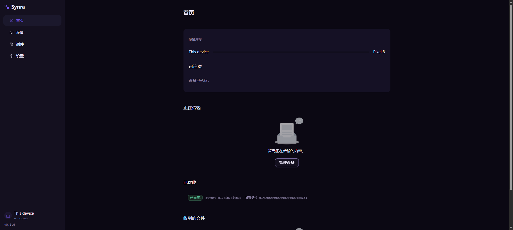
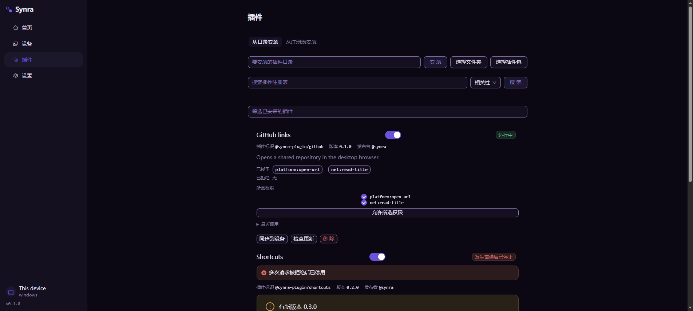
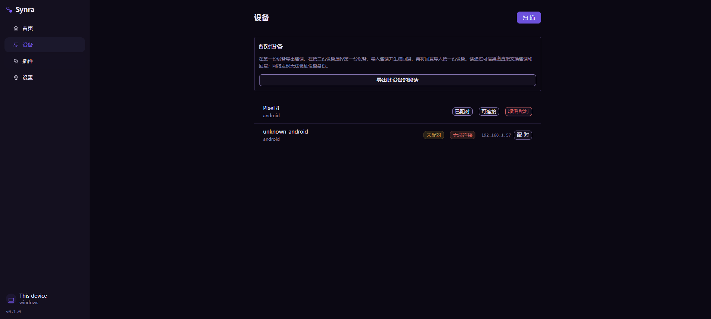
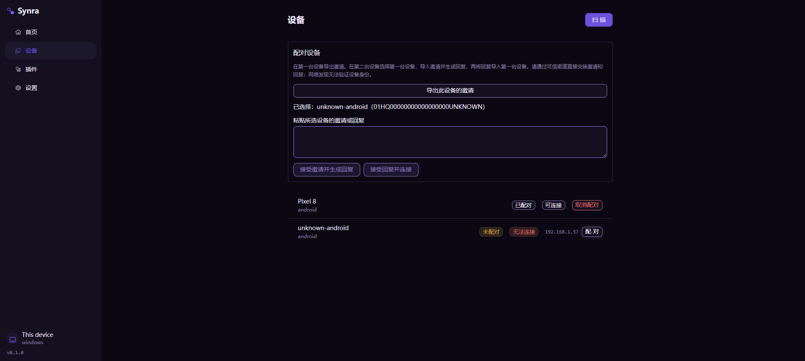
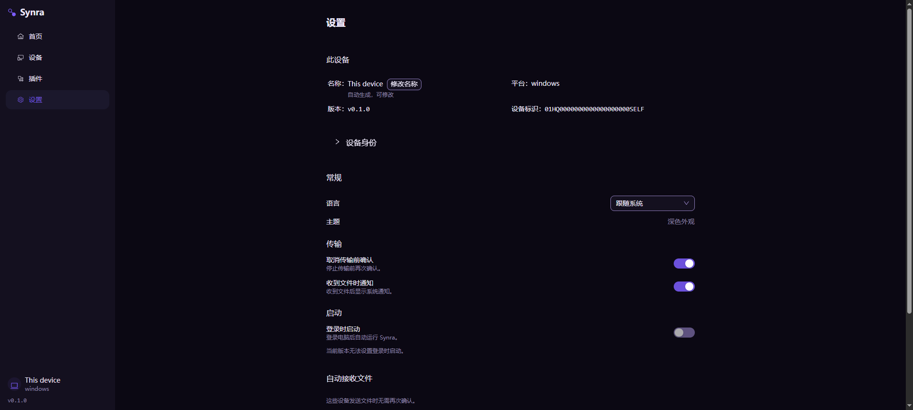
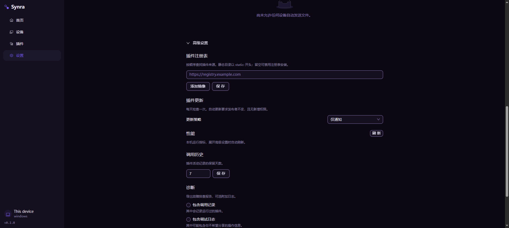
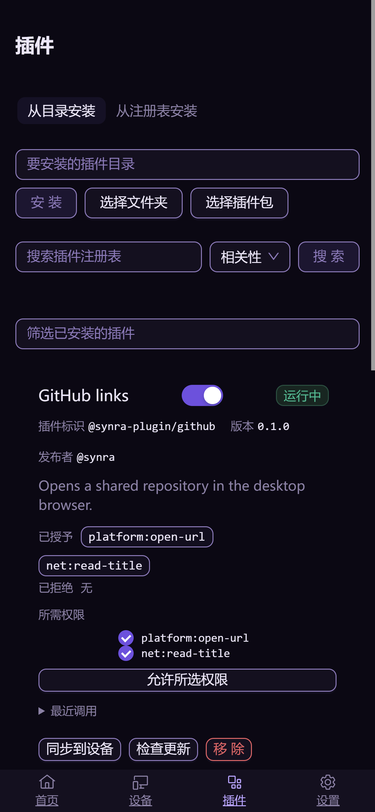
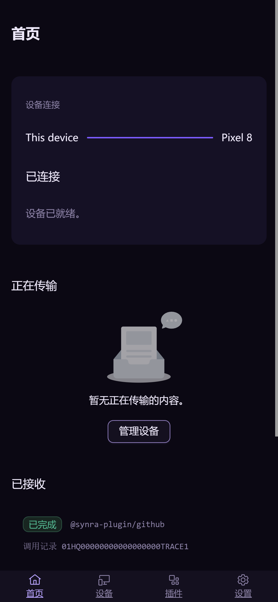

# 02 · 当前界面审查

## 1. 范围与方法

本轮重新读取 `synra-app@759af79` 四页及壳层源码，访问本地 Vite 假内核界面，逐页观察、保存并检查截图。
桌面视口 1904×855；手机模拟 390×844、DPR 3。截图展示的是当前版本，不是新设计。

核对目标：日常查看状态、发现/配对设备、寻找/管理插件、调整偏好和排查故障。
截图能证明信息占位和可见布局；不能证明 Native IPC、真实配对、安装、权限变更、托盘、读屏或跨 WebView 引擎均正确。

## 2. 当前值得保留的基础

- 四个一级入口已经清楚；桌面侧栏、窄栏、移动底栏都有现成结构。
- 视口约束与主区域内部滚动已经存在，本次不是重新解决整个文档滚动的问题。
- 共享主题和中英文已建立，说明文字已有次级色；不需要另一份颜色或组件库。
- 主程序已清除直接分享/剪贴板业务入口，后续整理应守住这个边界。
- 设置身份异常会强制展开，插件健康异常有可见提示；这些不能为了“简洁”删除。

## 3. 七步检查记录

| 步骤 | 画面与健康判断 | 当前风险 | 对应设计 |
| --- | --- | --- | --- |
| 1 | 首页：功能边界正确，信息密度失衡 | 巨大的连接面和多个空状态把唯一有内容的记录推后 | [05](./05-home-and-activity.md) |
| 2 | 插件：能力完整，默认页面过载 | 安装、注册表搜索、已安装筛选、权限管理在同一列抢占注意力 | [07](./07-plugins.md) |
| 3 | 设备：列表可读，入口层级欠清楚 | 总是显示长配对说明；“取消配对”与日常状态同样显眼 | [06](./06-devices-and-pairing.md) |
| 4 | 选择配对：操作可达，理解成本较高 | 输入、两种角色动作和完整说明同时出现，难辨下一步 | [06](./06-devices-and-pairing.md) |
| 5 | 设置：基本偏好清楚，身份元数据优先级偏高 | 打开设置先看版本/ID，常用偏好靠后；主题不是可选项仍占一行 | [08](./08-settings-and-system-surfaces.md) |
| 6 | 高级设置：折叠有帮助，展开后仍很长 | 注册表、性能、保留期限、诊断再次并列；预览不支持指标时出现页面级错误 | [08](./08-settings-and-system-surfaces.md) |
| 7 | 手机首页/插件：换行基本保住功能，长度仍过大 | 插件一项已占近一屏，主内容先被安装表单占用；首页空状态比记录更突出 | [03](./03-shell-and-navigation.md)、[09](./09-visual-and-components.md) |

### 步骤 1 · 首页

连接信息重复为“设备连接 / 两端名称 / 已连接 / 设备已就绪”，且用了大面积浮起面。
“正在传输”为空时仍有大插图和“管理设备”；有配对设备并不意味着用户需要再次管理设备。
“已接收”还混合任务状态，容易被误解为纯粹的文件接收历史。

### 步骤 2 · 插件

三个输入区域连续排列，用户先要判断是在安装、搜索注册表，还是筛选已安装内容。
健康插件也展开权限标签、权限复选框与授权按钮；每一项都像管理表单，无法快速扫描多个插件。
正常状态、错误、更新提示和删除都存在，问题是出现的层级，而不是缺少功能。

### 步骤 3–4 · 设备与配对

默认就要求用户阅读完整协议步骤；选择设备后更多内容插入顶部区域，列表位置改变。
“未配对”叠加红色“无法连接”可能把正常的发现候选渲染成故障；应区分信任状态和可达性。
地址可辅助辨认附近设备，但不能成为可信身份；配对安全提醒应在真正操作处清楚呈现。

### 步骤 5–6 · 设置

说明已经变淡，但数量和纵向分组距离仍大；把所有罕用项装进一个“高级”折叠只减少初始高度，没有改善查找路径。
高级面板展开时，假内核指标读取返回“此版本不支持这项操作”；本轮只观察这个限制，**不能据此断言原生性能模块坏了**。
设计上应把这种局部不可用放在性能区域，避免把整个设置页表现为失败。

### 步骤 7 · 手机

原始文件为 1170×2532，对应 390×844 CSS 像素。没有把图片大小当作布局尺寸。
这两张图证明功能堆叠与占位问题；本轮没有重新完成中英文全断点布局回归，不把先前测试当成本次证据。

## 4. 问题优先级

| 编号 | 优先级 | 问题 | 修正原则 | 验证方式 |
| --- | --- | --- | --- | --- |
| U01 | P0 | 插件默认项包含太多字段/表单 | 一行摘要＋点击详情，只有需处理状态加摘要 | 多插件截图、权限操作回归 |
| U02 | P0 | 安装/发现/已安装混杂 | 默认已安装，发现为分类，安装由按钮打开 | 新用户与回访用户各走一遍 |
| U03 | P0 | 首页空白插画挤压真实记录 | 局部空状态短句；首次使用才给完整引导 | 0/1/多任务、手机首屏 |
| U04 | P0 | hover 方案可能让功能不可发现 | 关键动作常显，更多可点击，focus 与 touch 等价 | 全键盘、触摸、混合输入 |
| U05 | P1 | 配对说明与动作同时堆叠 | 按邀请/回复角色组织当前步骤 | 两台设备方向切换、取消/过期 |
| U06 | P1 | 低频危险操作常显 | 更多菜单末尾，选择后明确确认 | 取消配对/移除/清理记录 |
| U07 | P1 | 设置分类不够精确 | 以目的分类，注册表和诊断直接定位 | 查找语言、注册表、错误修复 |
| U08 | P1 | ID/权限名与普通名称同等占位 | 标题保留名称；技术字段进详情并可完整复制 | 长 ID、重复名称、长权限范围 |
| U09 | P1 | 任务完成数据与演示差异 | 先忠实表现活动；历史能力单独定义 | 实际完成事件后列表行为 |
| U10 | P2 | 管理动作可能在多处语义漂移 | 共享可执行条件与忙碌态；命令入口后置 | 菜单/详情/快捷键参数一致 |

## 5. 可访问性风险与证据限制

截图中的正常小字号文本可以观察，但对比度是否合格以主题测试计算为准，不能凭“感觉淡”继续压低透明度。
当前若干开关的可访问名称在浏览器树中不明显，这是**需核对标签关联的风险**，不是仅凭截图已证实读屏失败。

后续必须实际验证：图标按钮名称、焦点顺序、菜单关闭后的归还、行内按钮的事件冒泡、200% 缩放、长中文/英文、软键盘与 safe-area。
本轮没有执行真实安装、导出诊断、修复身份、清除记录或取消配对，也未观察这些确认框的最终 Native 效果。
