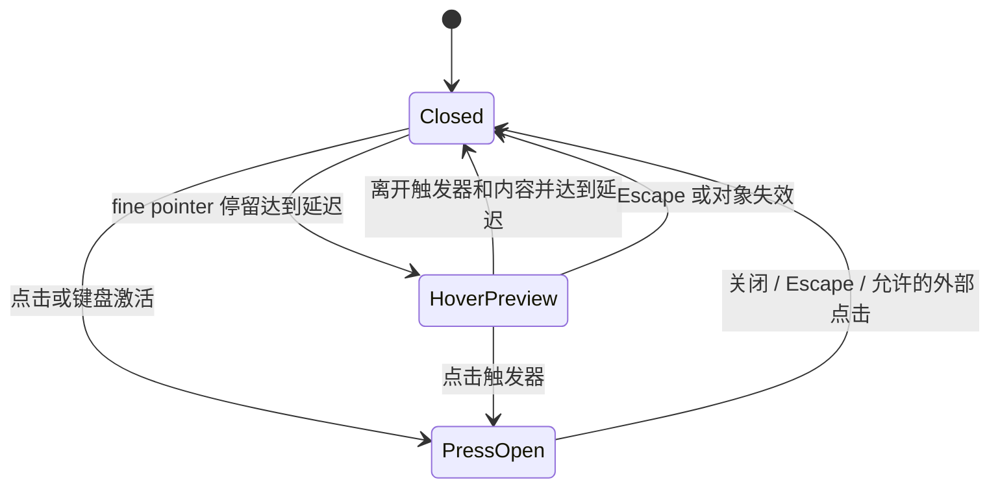

# 04 · 通用交互模式

> 🟡 目标交互契约。核心原则：**hover 帮助看得更快，点击负责明确动作，关键内容始终可达。**

## 1. 信息与动作分四层

| 层级 | 默认展示 | 典型内容 | 用户怎么进入 |
| --- | --- | --- | --- |
| L0 必须看见 | 常驻 | 名称、当前状态、进行中进度、错误摘要、待确认、主要动作、更多入口 | 无需额外触发 |
| L1 快速辅助 | hover/focus 显示；触摸有点击替代 | 图标名称、完整截断标题、精确时间、只读短预览 | 停留/聚焦/信息按钮 |
| L2 对象管理 | 点击进入 | 权限、版本/标识、配额、审计、详细错误、地址 | 详情或更多菜单 |
| L3 明确决策 | 单独流程或确认框 | 授予权限、更新新增权限、信任发布者、移除及删数据、取消配对 | 具名动作后明确确认 |

默认不能隐藏：系统异常、需授权数量/摘要、无法运行的原因、当前任务进度、接受/拒绝、取消中、错误恢复入口。
默认可以折叠：详细协议步骤、机器标识、完整权限清单、诊断字段、正常状态的重复说明。

## 2. 各类操作的可见性矩阵

| 对象 | 常显 | hover / focus 增强 | 更多 / 详情 | 触摸策略 |
| --- | --- | --- | --- | --- |
| 已配对设备 | 名称、平台图标、在线/离线、更多 | 查看详情快捷图标 | ID、可用地址、上次发现时间、取消配对 | 更多常显，名称进入详情 |
| 附近未配对设备 | 名称、未配对、配对按钮 | 可选只读辨认信息 | 完整 ID、地址 | 配对常显，信息点击可开 |
| 正常插件 | 名称、运行状态、启用开关、可用时的“打开”、更多 | 快捷查看详情 | 权限、检查更新、同步、审计、移除 | 打开/更多常显，开关不依赖 hover |
| 异常/待授权插件 | 上述＋短原因或待处理摘要 | 不隐藏恢复操作 | 详细错误、权限决策、配额 | 摘要与“处理”常显 |
| 进行中传输 | 对端、名称、进度、取消入口 | 精确信息 | ID、完整字段 | 取消常显，长名称进详情 |
| 任务决策 | 任务、候选对象、确认/拒绝 | 辅助说明 | trace、详细错误 | 决策始终常显 |
| 已有记录/接收文件 | 结果、名称/插件、时间（若有） | 精确时间、复制标识快捷入口 | 完整字段与复制 | 点开详情，复制按钮在详情常显 |
| 设置项 | 标签、值/控件、必要影响 | 次要解释 | 复杂帮助/高级字段 | 具名帮助按钮，不能要求长按 |

正常插件的“打开”和启用是两种动作，不合并为同一个开关。无 UI 插件不显示误导性的“打开”。
危险操作不安排成 hover 后直接出现的红色垃圾桶；更多菜单最后一组使用文字标签，执行前说明影响。

## 3. 选择正确的承载组件

| 需要 | 沿用的组件/模式 | 禁止的替代 |
| --- | --- | --- |
| 一个图标叫什么 | `ATooltip`＋`aria-label` | 只有 title 属性或没有名称的图标 |
| 一小段可选解释 | 只读 Tooltip / 点击帮助 Popover | 永远占两行的长介绍 |
| 包含复制、跳转等操作的信息 | `APopover` / 非模态信息层 | 在 `role=tooltip` 里放按钮 |
| 一组次要动作 | `ADropdown`＋`AMenu`，点击触发 | hover 才能打开的唯一菜单 |
| 当前对象较完整的管理 | 少量内容就地展开；较长内容用独立页或 `ADrawer`；需要对照时可并排 | 每个对象默认展开全部管理表单，或多层弹窗来回切换 |
| 单次安装、配对、修改信息 | 有明确起止的就地流程、`AModal` 或全宽流程，按步骤与内容量选择 | 触发后表单出现在视野外、找不到当前步骤或退出入口 |
| 授权、删除数据、修复身份 | 具名 `AModal`，完整影响与明确按钮 | 只有“确定/取消”的无对象确认 |
| 局部不可用/错误 | 对应区域 `AAlert` / `ErrorNotice` | 所有失败都顶到全页最上方 |

不自造平行的弹窗库；组件库提供语义基础，宿主负责业务状态、焦点验证和本地化。

## 4. hover / focus / press 状态规则

### 4.1 行内快捷操作

桌面指针进入行时显示快捷操作，离开后淡出；行内任一控件获得焦点或菜单已打开时保持显示。
行尾预留空间，不因出现按钮改变整行高度或挤动标题；快捷区不足时保留更多入口。
隐藏按钮不得形成看不见的点击热区；Tab 到达它们前/同时必须变为可见，不能用 `aria-hidden` 把可聚焦控件藏掉。

触摸和无 hover 环境直接显示主要操作与更多。使用输入能力判断与实际 pointer 类型，不只用窗口宽度猜设备。
禁止实现“第一次点击仅触发 hover，第二次才执行”的隐形两次点击规则。

### 4.2 只读预览

建议初值为打开延迟300ms、离开关闭延迟150ms；这是 Synra 的待验证建议，不是 Folo 的统一默认。
行尾按钮本身出现可用现有短动效 token，不能额外等待300ms才可点击。
交互延迟与动画时长分别管理；新增共享常量时放在宿主交互模块，若需要新增视觉 token 则通过 `@synra/theme`。

hover 打开的只读预览不夺焦点、不写数据；点击后保持打开直到明确关闭，不因鼠标移开就消失。
指针从触发器进入内容时保持，不在间隙闪烁；内容更新导致对象消失时安全关闭并保留合理焦点。
有复杂交互的预览优先直接进入详情，避免建立难以操作的微型管理面板。

### 4.3 三条硬约束

依据 [WCAG hover/focus 内容指引](https://www.w3.org/WAI/WCAG22/Understanding/content-on-hover-or-focus.html)：支持 Escape 关闭、指针进入不消失、阅读期间不自动计时消失。
普通说明可通过聚焦查看；长字段还须在详情中完整可选中/复制，不能让 tooltip 成为唯一读取途径。
授权、启动插件、检查更新、扫描、写配置、取消传输等动作**都不得由 hover/focus 自动执行**。

## 5. 键盘、触摸与事件

- Tab 顺序跟随视觉顺序；打开菜单用 Enter/Space，方向键选择菜单项，Escape 关闭后回触发器。
- 模态流程焦点进入标题/首个合理输入；危险确认不默认聚焦危险按钮；并排详情不锁焦点。
- 行内按钮阻止触发行打开，开关一次改变只提交一次；不要求双击才能进入功能。
- 所有图标按钮有本地化名称；如果被截断，tooltip 与完整详情提供补充，不能代替名称。
- 右键/长按仅作可选加速，更多按钮是完整替代；触控目标按44×44px验收。
- 输入法组合态期间 Enter 不触发提交、Escape 不误关流程；文本输入和弹层内暂停页面级单键快捷键。
- 关闭提示/详情只关闭表现层，真正的取消操作必须明确命名，不能混淆。

## 6. 动作反馈与失败恢复

| 状态 | UI 表现 | 真实状态来源 |
| --- | --- | --- |
| 点击后尚未返回 | 对应对象/按钮 busy，阻止重复提交 | 本次调用状态 |
| 请求已接收、任务仍运行 | 保留进行中、可用时给取消 | 任务/插件 store 事件或快照 |
| 成功 | 局部结果或短反馈；列表状态更新 | 成功返回与相应事件；不抢先假装完成 |
| 失败 | 原位原因＋可执行恢复入口，保留草稿 | `code/message/actions`，不能只剩 Something went wrong |
| 功能未支持 | 当前区域说明不可用 | 能力/命令返回，不伪造空数据 |
| 过期/对象消失 | 明确说明状态已变，重新读取或关闭 | 新快照/事件，不能提交旧对象 |

错误详情中的技术 ID/堆栈可收起；实际影响与恢复动作不能收起。成功消息可短暂显示，错误与待决策不自动消失。
菜单动作和详情动作调用同一个执行入口，共享 enabled/busy 与错误处理，避免“一个允许、一个禁止”。

## 7. 数据读取与性能

hover 只读已有快照，不注册事件订阅、不发网络、不加载审计、不运行环境检查。
审计、日志、性能和大详情按打开读取；收起/卸载取消可取消请求和定时器，旧响应用请求序号防止串到新对象。
不要每一行都挂常驻 timer；时间标签可用共享低频时钟，关闭页面时停止。任何新增定时器都需要说明用途与生命周期。

## 8. 可发现性验收

用户只看默认页面应能找到主要入口和更多入口；只用键盘、只用触摸也能完成同一组管理操作。
hover 出现的辅助动作必须在详情/菜单有等价路径。若第一次使用需要提示，只提示一次、就近说明，不能在每行永远写“鼠标悬停查看更多”。
